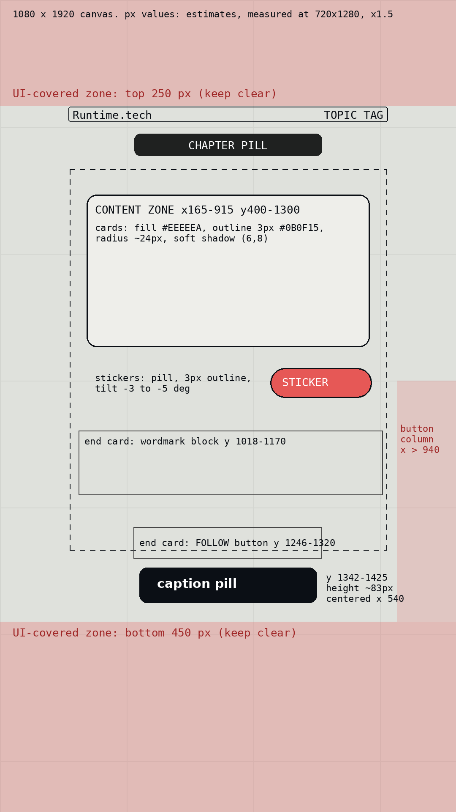

# Runtime.tech visual system (plans/style.md)

The style guide for every Runtime.tech video. `$video-planner` reuses this file as-is. `$remotion-builder` generates `src/theme.ts` from the token block below. Do not replace it unless the creator asks to change the style.

**Source:** measured from one reference video (45 s, 720 x 1280) on 2026-11-09 using extracted frames. All pixel values here are for the 1080 x 1920 canvas (reference values x 1.5). Colors were sampled from frames; values marked "estimate" were judged by eye. The images in `references/runtime-style/` show the look; this file gives the numbers. When the two disagree, trust the images, then correct this file.

## 1. The look in one paragraph

A calm, technical "report" look: a light gray-green canvas with a faint grid, white-ish cards with thick ink outlines and soft offset shadows, one small mono header, and physical labels (price tags, stickers, stamps) that carry each claim. Mechanisms are shown on a dark navy blueprint canvas with a glowing scale or diagram. A black caption pill sits low and reveals words as they are spoken. The camera is stable; things pop, slide and dim, nothing shakes. Everything reads in under two seconds on a phone.

## 2. Tokens (generate `src/theme.ts` from this block)

```ts
export const theme = {
  canvas: { width: 1080, height: 1920, fps: 30 },

  light: {
    bgCenter: '#DFE1DC',      // radial vignette: center
    bgEdge: '#D1D3D0',        // radial vignette: edges (slightly darker)
    gridMajor: '#D3D5D0',     // estimate, ~2 px lines
    gridMinor: '#D9DBD6',     // estimate, very faint finer grid
    surface: '#EEEEEA',       // cards (never pure white)
    ink: '#0B0F15',           // outlines, caption pill, text (never pure black)
    inkSoft: '#474648',       // secondary big numbers
    faded: '#BCC0C6',         // the old / replaced value
    mono: '#6C6C6C',          // small mono labels on cards
  },

  dark: {                     // "blueprint" scenes
    bg: '#222B44', bgMid: '#253352',   // center is slightly lighter
    grid: '#2C3D5E',
    scanlines: 'rgba(255,255,255,0.04)', // estimate: faint horizontal lines
    text: '#E2F5FF',
    mono: '#B3E2FB',
    panel: '#334A6A',
    glow: '#5C83A5',          // pill border glow, brighter cyan at the core
    rulerFrom: '#3E8297', rulerTo: '#416C9A',
    marker: '#81E1C8',        // mint highlight
    delta: '#E6CF6D',         // yellow difference / bracket
  },

  accent: {
    red: '#E65856',           // price up, warning, stamp
    green: '#32AF7A',         // good deal, positive verdict
    yellow: '#EECE61',        // best seller / highlight tag
    blue: '#556BD1',          // icons inside mini-UI cards
    gold: '#C9BC92',          // outline of the highlighted row
    beige: '#E9E3D0',         // estimate: fill of the highlighted row
  },

  caption: {
    fill: '#0B0F15', active: '#FFFFFF',   // spoken words
    upcoming: '#65696F',                  // not yet spoken
    radius: 18, height: 83, centerY: 1383, centerX: 540,
  },

  radius: { card: 24, pill: 18, sticker: 21 },   // sticker may be a full pill
  stroke: { card: 3, sticker: 3 },
  shadow: { card: '6px 8px 14px rgba(11,15,21,0.18)' },   // estimate
  safe: { top: 250, bottom: 450, rightX: 940, contentX: [165, 915], contentY: [400, 1300] },

  motion: {
    pop: 0.35, enter: 0.4, exit: 0.25, dim: 0.2,   // seconds
    easing: 'cubic-bezier(0.22, 1, 0.36, 1)',      // ease-out; use spring() for pops
  },
};
```

## 3. Typography

| Role | Latin | Arabic (Darija) | Size at 1080 | Notes |
|---|---|---|---|---|
| Display (numbers, headlines, wordmark) | heavy grotesk, weight 800 to 900 | Tajawal 800 | numbers about 100 px; card headlines about 45 px; wordmark cap height about 150 px | Closest free Latin match to try first: Archivo 800/900 or Inter Tight 800. The exact reference font was not identified. |
| Captions | same family, 800 | Tajawal 800 | 58 px Latin, 64 px Arabic | white on the pill |
| Mono labels (header, chapter pills, tags, units) | JetBrains Mono 500 to 800 (closest free match, not identified) | Latin only, see section 8 | header 22 px, chapter pill 33 px, tags 22 to 24 px | uppercase, letter-spaced about 0.1 to 0.14 em |

Load fonts with `@remotion/google-fonts`. Compare the first still to `references/runtime-style/02-compare-card.jpg` and adjust the Latin display font if the weight or width looks off.

## 4. Layout (1080 x 1920)



- **Header strip** (body scenes only): left `Runtime.tech` (bold `Runtime`, regular `.tech`, exact case), right a topic tag in Latin mono caps, for example `HOW IT WORKS · DNS`. Center y about 270, x from 162 to 914. The reference header sits at y about 240, inside the top 250 px that the app covers, so it is moved down here.
- **Chapter pill:** centered, y 316 to 368, about 440 px wide, fill `#1F2120` (light scenes) or `dark.panel` with glow (blueprint scenes). Optional mono subtitle under it in caps (bold, `dark.mono` or `light.mono`), then content starts at y 440 instead of 400.
- **Content zone:** x 165 to 915, y 400 to 1300. Nothing important outside it.
- **Caption pill:** centered at x 540, y 1342 to 1425 (stays above the bottom 450 px zone).
- **Hook and end card:** clean. No header, no chapter pill, and the hook has no caption until speech starts.
- **End card block:** devices or objects at y 540 to 950, wordmark at y 1018 to 1170, button at y 1246 to 1320.
- **Right-edge button column:** keep everything left of x 940.

## 5. Components (build once in `src/components/`, reuse across videos)

| Component | What it is |
|---|---|
| `GridCanvas` | `mode: 'light' | 'dark'`. Vignette, major and minor grid. The grid scale and position drift slowly across a scene (spacing varies from about 200 to 300 px between scenes). Dark mode adds scanlines and a lighter center. |
| `HeaderStrip` | The mono header described in section 4. |
| `ChapterPill` | Pill with caps text and an optional icon, optional mono subtitle. Announces each beat in one to three words. |
| `CaptionPill` | Black rounded pill, 2 to 4 words, spoken words white, upcoming words dim. Hidden during pauses. |
| `Card` | `#EEEEEA`, 3 px ink outline, radius 24, offset shadow. Optional tilt up to 2 degrees. |
| `StickerPill` | Flat colored pill, bold mono caps, white text (ink text on yellow). Red and yellow have a thin ink outline, green may have none. Tilt about -3 to -5 degrees. |
| `ValueTag` | Hanging tag: small ring on top, thin string to the object, big heavy value, mono caption under it. The new value is bold ink; the old value fades to `faded`. |
| `Stamp` | Red double-outline rotated about -12 degrees, semi-transparent with a slight grain, drawn over an object. |
| `NotifCard` | Headline-style card: red mono category label, bold headline, two grey placeholder lines, small blue icon. Stack three or four with small offsets and rotations. |
| `ScaleBar` | Blueprint ruler with ticks, labels, a marker with a triangle, and a yellow bracket showing the difference. |
| `MiniUI` | Clean card with rows. The highlighted row has a gold outline and beige fill, with small ink tags ("1 SHOWN FIRST") and a yellow tag ("BEST SELLER"). This is the save frame. |
| `ScanLine` | Thin cyan glow line that sweeps over a wordmark or object. |
| `DeviceMock` | Generic phone drawn flat, thick gray bezel, soft gradient screen. No phone-maker logos; app logos on its screen follow section 14. |
| `EndCard` | Section 6, scene 8. |

For computer science topics, extend the same vocabulary rather than inventing a new look: `NodeBox` (server, client, database), `PacketChip`, `FlowArrow` (thick ink line with a mono label), `CodeCard` (card with at most 5 lines, one line highlighted). Same outlines, same fills, one accent color per meaning.

## 6. Scene recipes and structure

The reference runs: hook, same-subject comparison, evidence stack, dark blueprint for the mechanism, a second mechanism beat, a "steal it" example card, a "next time" application, an end card. Map your script to these roles:

1. **Hook (about 0 to 6 s, role: hook).** Clean canvas, one hero object, no header. A hanging tag or a bold statement appears in the first second.
2. **Compare (role: open loop).** Two objects side by side, each with a `ValueTag`. A green or red `StickerPill` under the one the viewer will misjudge.
3. **Evidence stack (role: explain).** `NotifCard`s fan in, one per spoken idea.
4. **Blueprint scene (role: explain / aha).** Dark canvas with the mechanism drawn on a `ScaleBar` or diagram. Use for the main "how it works" idea. A short scan or glow transition into the dark scene is optional (not captured in the frames I sampled); keep it under 0.5 s.
5. **Second mechanism beat (role: explain).** Back to the light canvas, chapter pill "JOB 2" style, one new element per idea.
6. **Steal-it card (role: save frame).** A clean `MiniUI` that builds row by row, then holds for at least 2 seconds.
7. **Next time (role: aha / CTA).** One or two short beats applying the idea to the viewer's own life.
8. **End card (role: CTA).** Clean canvas, the objects from the video, a `Stamp`, the wordmark `Runtime.tech` in heavy display type (exact case) with a `ScanLine`, a mono tagline in caps, and a dark `FOLLOW` button with an arrow. The button text comes from the script's closing line.

## 7. Motion

- **Sticker pop:** opacity 0 to 1 in about 3 frames; scale about 0.6 to 1.08 to 1.0 over about 0.35 s; starts rotated about -10 degrees and settles at -3 to -5 degrees (estimated from a 15 fps strip).
- **Cards:** slide up about 40 px and fade in over 0.4 s. Stacks enter about 0.25 s apart.
- **Replacing a value:** the old value fades to `faded`, then the new value types or pops in at full ink.
- **Exits:** scale down slightly and fade over 0.25 s, or hard cut on a pause.
- **Camera:** stable. At most a slow push-in from 1.00 to 1.03 over a scene. No shake.
- **Everything animates from the frame counter**, with the timing rules in `$remotion-builder`.

## 8. Pace

Measured on the reference: 18 distinct visual events in 45 s (one every 2.5 s on average), the longest gap 5.0 s, the shortest 0.6 s. Target: a new element or state change at least every 3 s on average, never more than 5 s without one. Chapter pills change about every 5 to 7 s.

## 9. Arabic (Darija) adaptation

- Captions, chapter pills, card text and big headlines are Arabic in Tajawal, right-to-left. Header, mono tags, units and technical terms stay Latin and left-to-right.
- **Never apply letter-spacing to Arabic.** Only Latin mono labels are letter-spaced.
- Reading order inside a scene: choose one direction per scene. Lists, steps and before/after read right to left for Arabic text. Technical flows with Latin labels (browser to server) may stay left to right. Do not mix within a scene.
- Caption pill: Arabic words appear right to left, upcoming words dim.
- Test one Arabic caption and one Arabic card in the first still (see `$remotion-builder`).

## 10. Look-alike checklist (compare every review still against this)

1. Background is the light vignette canvas with grid, or the dark navy blueprint canvas. No other backgrounds.
2. Cards use `#EEEEEA`, a 3 px ink outline, radius about 24 and an offset shadow. Never pure white, never gradients.
3. Ink is `#0B0F15`, not pure black.
4. Accents are only red, green, yellow, blue, plus mint and yellow on dark. One meaning per color in the whole video.
5. Header is present in body scenes only, below y 250. Hook and end card have none.
6. Caption pill sits at x 540, y 1342 to 1425, with at most 4 words and upcoming words dim.
7. Mono labels are uppercase Latin and letter-spaced; Arabic is not.
8. Every claim has a physical label (tag, sticker, stamp or bracket), not just a line of text.
9. Content stays inside x 165 to 915, y 400 to 1300 (end card inside y 540 to 1320).
10. A change on screen at least every 3 s on average, never a 5 s gap.
11. The save frame is a clean card held for at least 2 s.
12. Images follow section 14: photos inside an `ImageCard` frame, never full-bleed, no identifiable faces, no personal information. Brands the video names use their real logo (section 14); generic objects stay drawn.

## 11. Copy the system, not the brand

Do not reuse: the reference channel's name or tagline, its header wording, its stamp word, any Apple name, logo, product, price or headline, or the example brand shown in the steal-it card. Use instead:

- Header: `Runtime.tech` plus your own topic tag.
- Stamp word: your own (to decide, see below).
- Wordmark: `Runtime.tech`.
- Examples: invented brands and generic devices.

## 12. Still to decide (ask the creator once, then write the answer here)

- Tagline under the wordmark (a short mono caps line). Until set, use `TECH · EXPLAINED SIMPLY`.
- Stamp word for the end card and where else to use stamps. Until set, use `EXPLAINED`.
- Whether the follow button text is Darija or Latin. Until set, take it from the script's closing line.

## 13. Reference files

`references/runtime-style/` contains `01-hook` to `07-sticker-green` (key frames), `contact-sheet-1` to `3` (the whole video every 1.5 s) and `layout-spec.png` (annotated layout). Look at them before planning or building a scene. An optional `reference.mp4` may be added there; never use it as footage.

## 14. Images (added 2026-11-20)

Some concepts are clearer as a real image than as an animation: real-world objects and places (an ATM, a police station, a phone getting a message), real examples (a scam message as people receive it), anything the viewer must recognize from daily life. Mechanisms and invisible processes (data flowing, an overlay, a code reaching the scammer) stay animated.

- **Frame:** an image always sits in an `ImageCard`: the `Card` outline (3 px ink, radius 24, offset shadow), optional tilt up to 2 degrees, inside the content box (x 165 to 915, y 400 to 1300). Never a full-screen photo, so the grid canvas and the look stay recognizable.
- **Labels:** every image carries at least one system element on top (a `StickerPill`, `ValueTag`, `Stamp` or arrow) that says why it is there.
- **Motion:** card enter as in section 7, then at most a slow push-in or pan (scale 1.00 to 1.06 over the scene). No shake, no fast zooms.
- **Treatment:** keep the photo's own colors but avoid saturated or busy images; crop to the one thing that matters.
- **Content rules:** no identifiable faces (crop, blur or pick another image), no personal information (phone numbers, names, account numbers: blur them).
- **Brand logos (creator's rule, 2026-11-21):** when the video talks about a real brand, app or service (BaridiMob, Algérie Poste, Play Store, App Store, Facebook, Telegram…), show its **real logo** as an image instead of drawing a stand-in. Use the official logo file (Wikimedia Commons or the brand's own site), keep it unaltered and recognizable, and list it in the plan's Images table. Limits: never make the video look like it comes from that brand (no fake official screens signed with the logo, no logo on the scammer's side, the `Runtime.tech` header stays), and never put a real logo on something fake (a fake app, a fake page): fakes stay drawn and labelled as fake. Logos may sit directly on the canvas or inside drawn UI (a logo tile, a store badge) without an `ImageCard` frame.
- **Sources and licences:** prefer free-licence sources (Wikimedia Commons, Pexels, Unsplash, Pixabay). Press photos or screenshots only with the creator's approval. Every image's source URL and licence is listed in the plan.
